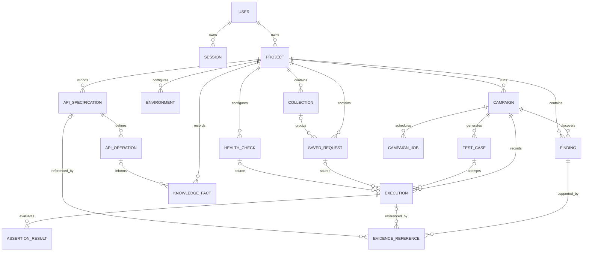

# DATABASE_DESIGN.md

**Project:** API Intelligence Platform  
**Status:** Proposed MVP schema; subordinate to `SOURCE_OF_TRUTH.md`, `TECHNICAL_DESIGN.md`, and `API_CONTRACT.md`  
**Version:** 1.0  
**Last updated:** 2026-10-16  
**Database:** PostgreSQL; SQLAlchemy ORM; Alembic migrations

> This document proposes the persistence model for the MVP. It is not a statement that migrations or tables already exist. The schema favors clear ownership, traceable evidence, and reliable campaign recovery without introducing a separate queue, vector database, or graph database. If implementation changes a material relationship or retention rule, update this document and record the decision before allowing dependent modules to diverge.

## 1. Design Principles

1. PostgreSQL is the authoritative store for application users, projects, API assets, campaign state, execution records, and evidence.
2. Use UUID primary keys for externally visible resources. Generate IDs in the application or database consistently; never derive authorization from an ID's secrecy.
3. Use timezone-aware timestamps stored in UTC.
4. Enforce project ownership through explicit foreign keys and server-side authorization. Database constraints complement, but do not replace, authorization checks.
5. Keep raw execution facts separate from later interpretation. Re-analysis must not rewrite what the target API returned.
6. Store provenance for declared, extracted, observed, and inferred information.
7. Bound the size and retention of response bodies, imported specifications, and evidence payloads.
8. Store secrets separately from ordinary request/environment configuration where feasible; never return stored secret values after write.
9. Campaign state and worker claim metadata must survive process restarts.
10. Use Alembic for every schema change. Do not edit production schemas manually or rely on ORM `create_all()` as a migration strategy.

## 2. Naming and Column Conventions

- Table names: lowercase `snake_case`, plural only where consistent with the existing codebase; this document uses singular table names for clarity.
- Column names: lowercase `snake_case`.
- Primary key: `id UUID PRIMARY KEY`.
- Foreign keys: `{referenced_entity}_id`.
- Timestamps: `created_at TIMESTAMPTZ NOT NULL DEFAULT now()` and `updated_at TIMESTAMPTZ NOT NULL DEFAULT now()` where the entity is mutable.
- Use PostgreSQL `JSONB` for bounded flexible configuration and normalized schema fragments, not as a substitute for relationships that need joins, constraints, or filtering.
- Use `TEXT` for unbounded textual content only when application-level byte limits are enforced. Use bounded `VARCHAR` for identifiers/names with clear length limits.
- Prefer named constraints and indexes so migrations and database errors are diagnosable.
- Store enum-like values as validated strings or PostgreSQL enums only after considering migration friction. MVP recommendation: Python enums validated by Pydantic/domain code and `CHECK` constraints for important persisted state/category values.
- Avoid storing computed counters as authoritative unless atomically maintained. Derive counts from records or store cached counters with explicit consistency rules.

## 3. Entity Relationship Overview

The diagram is conceptual. A module may combine small tables if the resulting implementation remains easy to test and query, but must preserve the data integrity and provenance rules below.

## 4. Tables

### 4.1 `user`

Stores the application identity associated with a verified Google identity.

| Column | Type | Constraints / notes |
|---|---|---|
| `id` | UUID | PK |
| `google_subject` | VARCHAR(255) | NOT NULL, UNIQUE; stable Google `sub` claim |
| `email` | VARCHAR(320) | NOT NULL; normalized for display/search, not the identity key |
| `display_name` | VARCHAR(200) | Nullable |
| `avatar_url` | TEXT | Nullable; validate/limit length; display only, not trusted for authorization |
| `created_at` | TIMESTAMPTZ | NOT NULL |
| `updated_at` | TIMESTAMPTZ | NOT NULL |

Indexes/constraints:
- Unique index on `google_subject`.
- Index on normalized `email` only if lookup or account support requires it. Email uniqueness should not be the identity invariant unless account-linking rules explicitly require it.

### 4.2 `session`

Opaque, revocable browser sessions stored server-side.

| Column | Type | Constraints / notes |
|---|---|---|
| `id` | UUID | PK |
| `user_id` | UUID | NOT NULL FK to `user.id`, `ON DELETE CASCADE` |
| `token_hash` | BYTEA or VARCHAR(128) | NOT NULL, UNIQUE; store a hash of a high-entropy random token, not the raw cookie value |
| `created_at` | TIMESTAMPTZ | NOT NULL |
| `expires_at` | TIMESTAMPTZ | NOT NULL |
| `last_seen_at` | TIMESTAMPTZ | Nullable; update cadence must avoid a write on every request if unnecessary |
| `revoked_at` | TIMESTAMPTZ | Nullable |
| `csrf_token_hash` | BYTEA or VARCHAR(128) | Nullable, if the chosen CSRF scheme uses a server-stored token |

Indexes:
- Unique index on `token_hash`.
- Index on `(user_id, expires_at)` for cleanup and account session management.
- Index on `expires_at` for cleanup.

Session validation must reject expired/revoked sessions. Expired session cleanup can be a periodic maintenance task; correctness must not depend on cleanup having run.

### 4.3 `project`

Top-level ownership and data-isolation boundary.

| Column | Type | Constraints / notes |
|---|---|---|
| `id` | UUID | PK |
| `owner_user_id` | UUID | NOT NULL FK to `user.id`, `ON DELETE CASCADE` |
| `name` | VARCHAR(120) | NOT NULL |
| `description` | VARCHAR(2000) | Nullable |
| `created_at` | TIMESTAMPTZ | NOT NULL |
| `updated_at` | TIMESTAMPTZ | NOT NULL |

Indexes:
- `(owner_user_id, updated_at DESC)` for project listing.
- Consider unique `(owner_user_id, lower(name))` only if product policy requires names to be unique per owner; otherwise allow duplicate names.

MVP authorization is owner-based. If team collaboration is later approved, introduce a membership model rather than overloading `owner_user_id`.

### 4.4 `collection`

| Column | Type | Constraints / notes |
|---|---|---|
| `id` | UUID | PK |
| `project_id` | UUID | NOT NULL FK to `project.id`, `ON DELETE CASCADE` |
| `name` | VARCHAR(120) | NOT NULL |
| `description` | VARCHAR(2000) | Nullable |
| `created_at` | TIMESTAMPTZ | NOT NULL |
| `updated_at` | TIMESTAMPTZ | NOT NULL |

Indexes:
- `(project_id, name)`.
- `(project_id, updated_at DESC)`.

Collection deletion must not cascade-delete historical executions. Recommended behavior: set `saved_request.collection_id` to `NULL` when a collection is deleted.

### 4.5 `saved_request`

Stores a reusable HTTP request definition. Execution snapshots must be stored separately so later edits do not change history.

| Column | Type | Constraints / notes |
|---|---|---|
| `id` | UUID | PK |
| `project_id` | UUID | NOT NULL FK to `project.id`, `ON DELETE CASCADE` |
| `collection_id` | UUID | Nullable FK to `collection.id`, `ON DELETE SET NULL`; application must verify same-project association |
| `name` | VARCHAR(160) | NOT NULL |
| `method` | VARCHAR(10) | NOT NULL; CHECK against approved HTTP methods |
| `url_template` | TEXT | NOT NULL; application-level max length 8192 |
| `path_params` | JSONB | NOT NULL DEFAULT `{}` |
| `query_params` | JSONB | NOT NULL DEFAULT `[]`; ordered list of `{key,value,enabled}` |
| `headers` | JSONB | NOT NULL DEFAULT `[]`; ordered list; sensitive values redacted on reads/logging |
| `body_config` | JSONB | NOT NULL DEFAULT `{"mode":"none"}`; validated schema |
| `auth_config` | JSONB | NOT NULL DEFAULT `{"type":"none","config":{}}`; secrets protected and masked on reads |
| `created_at` | TIMESTAMPTZ | NOT NULL |
| `updated_at` | TIMESTAMPTZ | NOT NULL |

Indexes:
- `(project_id, updated_at DESC)`.
- `(collection_id, updated_at DESC)`.

Validation rules:
- Enforce approved method, supported auth/body modes, entry count limits, and configuration size limits in Pydantic/domain validation.
- JSONB flexibility does not waive schema validation.
- Avoid placing long-lived plaintext secrets in `auth_config`. If secrets must be stored, encrypt at application level with a key supplied outside PostgreSQL, or use a deliberate secret-management design. Reads return masked/write-only values.

### 4.6 `environment`

| Column | Type | Constraints / notes |
|---|---|---|
| `id` | UUID | PK |
| `project_id` | UUID | NOT NULL FK to `project.id`, `ON DELETE CASCADE` |
| `name` | VARCHAR(120) | NOT NULL |
| `variables` | JSONB | NOT NULL DEFAULT `[]`; variable metadata and non-secret values |
| `created_at` | TIMESTAMPTZ | NOT NULL |
| `updated_at` | TIMESTAMPTZ | NOT NULL |

Use an array of validated variable records such as `{key, value, is_secret}` to preserve UI order, or normalize variables into a separate table if individual variable lookup/rotation becomes important. **Recommended for MVP:** separate `environment_variable` rows to support per-variable uniqueness and write-only secret handling.

#### 4.6.1 `environment_variable`

| Column | Type | Constraints / notes |
|---|---|---|
| `id` | UUID | PK |
| `environment_id` | UUID | NOT NULL FK to `environment.id`, `ON DELETE CASCADE` |
| `key` | VARCHAR(128) | NOT NULL |
| `value_plain` | TEXT | Nullable; only for non-secret values |
| `value_ciphertext` | BYTEA | Nullable; encrypted secret value, if application-level encryption is implemented |
| `is_secret` | BOOLEAN | NOT NULL DEFAULT false |
| `created_at` | TIMESTAMPTZ | NOT NULL |
| `updated_at` | TIMESTAMPTZ | NOT NULL |

Constraints:
- Unique `(environment_id, key)`.
- Enforce exactly one value storage path appropriate to `is_secret`; do not store the same secret in plaintext and ciphertext.
- If a secure encryption key/configuration is not available, do not claim secret values are safely persisted. Prefer write-only secrets handled by a documented secure mechanism, or disable persisted secret variables for the MVP.
- API responses never return secret plaintext after write; a masked flag may indicate that a secret is configured.

### 4.7 `api_specification`

Represents an imported OpenAPI document/version.

| Column | Type | Constraints / notes |
|---|---|---|
| `id` | UUID | PK |
| `project_id` | UUID | NOT NULL FK to `project.id`, `ON DELETE CASCADE` |
| `title` | VARCHAR(255) | Nullable |
| `version_label` | VARCHAR(128) | Nullable |
| `openapi_version` | VARCHAR(32) | Nullable until parse completes |
| `source_kind` | VARCHAR(16) | CHECK: `upload` or `url` |
| `source_label` | TEXT | Safe display label; avoid storing sensitive URL query strings |
| `content_hash` | VARCHAR(80) | NOT NULL; SHA-256 digest with algorithm label or separate digest column |
| `document_json` | JSONB | NOT NULL if within configured storage limits; alternative bounded text/blob is acceptable if parser fidelity requires it |
| `parse_status` | VARCHAR(16) | CHECK: `pending`, `completed`, `partial`, `failed` |
| `parse_warnings` | JSONB | NOT NULL DEFAULT `[]` |
| `created_at` | TIMESTAMPTZ | NOT NULL |

Indexes:
- `(project_id, created_at DESC)`.
- `(project_id, content_hash)` for duplicate detection.

Do not automatically fetch external `$ref` documents. Store the content/hash used for analysis so evidence can identify the exact contract version. If imported documents may exceed reasonable JSONB limits, use a bounded text/blob strategy and store normalized operation data separately.

### 4.8 `api_operation`

Normalized operation extracted from one specification.

| Column | Type | Constraints / notes |
|---|---|---|
| `id` | UUID | PK |
| `specification_id` | UUID | NOT NULL FK to `api_specification.id`, `ON DELETE RESTRICT` while retained evidence references the spec; otherwise archive policy applies |
| `method` | VARCHAR(10) | NOT NULL, CHECK against supported methods |
| `path` | TEXT | NOT NULL |
| `operation_id` | VARCHAR(255) | Nullable |
| `summary` | VARCHAR(1000) | Nullable |
| `description` | TEXT | Nullable, bounded during import |
| `tags` | JSONB | NOT NULL DEFAULT `[]` |
| `parameters` | JSONB | NOT NULL DEFAULT `[]` |
| `request_body_schema` | JSONB | Nullable normalized schema/reference representation |
| `responses` | JSONB | NOT NULL DEFAULT `[]` |
| `source_pointer` | VARCHAR(2048) | Nullable JSON Pointer into the imported specification |
| `created_at` | TIMESTAMPTZ | NOT NULL |

Constraints/indexes:
- Unique `(specification_id, method, path)` for normalized operation identity.
- Index `(specification_id, method)`.
- Optional GIN index on `tags` only if tag filtering warrants it.

Do not duplicate the entire source document into every operation row. Use normalized, size-bounded schemas and source pointers.

### 4.9 `knowledge_fact`

Stores normalized facts and hypotheses used by API understanding and adaptive selection. Avoid a vector database for the MVP.

| Column | Type | Constraints / notes |
|---|---|---|
| `id` | UUID | PK |
| `project_id` | UUID | NOT NULL FK to `project.id`, `ON DELETE CASCADE` |
| `specification_id` | UUID | Nullable FK to `api_specification.id`, `ON DELETE SET NULL` only if the source reference is preserved as a snapshot |
| `operation_id` | UUID | Nullable FK to `api_operation.id`, `ON DELETE SET NULL` only if source snapshot is retained |
| `fact_type` | VARCHAR(64) | NOT NULL, e.g. `field_semantics`, `resource_relation`, `observed_shape`, `workflow_hint` |
| `provenance` | VARCHAR(16) | CHECK: `DECLARED`, `EXTRACTED`, `OBSERVED`, `INFERRED` |
| `subject` | VARCHAR(512) | NOT NULL; concise subject such as a JSON path or operation key |
| `value_json` | JSONB | NOT NULL; bounded normalized value |
| `confidence` | NUMERIC(4,3) | Nullable, range 0–1; confidence is not proof |
| `rationale` | TEXT | Nullable, bounded, evidence-based explanation |
| `source_reference` | JSONB | NOT NULL DEFAULT `{}`; e.g. JSON Pointer, execution ID, response JSON path, inference run inputs |
| `is_active` | BOOLEAN | NOT NULL DEFAULT true; use supersession/versioning rather than erasing history where practical |
| `created_at` | TIMESTAMPTZ | NOT NULL |

Indexes:
- `(project_id, fact_type, created_at DESC)`.
- `(operation_id, fact_type)`.
- GIN index on `source_reference` only if query patterns justify it.

Do not store private model chain-of-thought. `rationale` is a concise, user-facing explanation tied to evidence.

### 4.10 `health_check`

| Column | Type | Constraints / notes |
|---|---|---|
| `id` | UUID | PK |
| `project_id` | UUID | NOT NULL FK to `project.id`, `ON DELETE CASCADE` |
| `name` | VARCHAR(160) | NOT NULL |
| `request_config` | JSONB | NOT NULL; same validated request-definition schema used by execution |
| `assertions` | JSONB | NOT NULL DEFAULT `[]`; deterministic operators only |
| `created_at` | TIMESTAMPTZ | NOT NULL |
| `updated_at` | TIMESTAMPTZ | NOT NULL |

Index `(project_id, updated_at DESC)`. Historical runs are represented by `execution` rows with a nullable `health_check_id`; deleting a check must not delete those executions.

### 4.11 `campaign`

Durable test campaign definition and state.

| Column | Type | Constraints / notes |
|---|---|---|
| `id` | UUID | PK |
| `project_id` | UUID | NOT NULL FK to `project.id`, `ON DELETE CASCADE` for a user-requested project deletion only after retention policy is applied |
| `name` | VARCHAR(120) | NOT NULL |
| `state` | VARCHAR(16) | NOT NULL CHECK: `queued`, `running`, `completed`, `failed`, `cancelled` |
| `mode` | VARCHAR(16) | NOT NULL CHECK: `baseline`, `adaptive` |
| `specification_id` | UUID | Nullable FK to `api_specification.id`; retained snapshot/hash must remain available for historical evidence |
| `environment_id` | UUID | Nullable FK to `environment.id`; execution snapshots must not depend on future environment edits |
| `configuration` | JSONB | NOT NULL; validated campaign options and selected target operation IDs |
| `max_requests` | INTEGER | NOT NULL CHECK > 0 |
| `max_iterations` | INTEGER | NOT NULL CHECK > 0 |
| `deadline_seconds` | INTEGER | NOT NULL CHECK > 0 |
| `per_request_timeout_seconds` | NUMERIC(7,2) | NOT NULL CHECK > 0 |
| `max_response_bytes` | INTEGER | NOT NULL CHECK > 0 |
| `allow_llm` | BOOLEAN | NOT NULL DEFAULT false |
| `requests_started` | INTEGER | NOT NULL DEFAULT 0 CHECK >= 0 |
| `tests_generated` | INTEGER | NOT NULL DEFAULT 0 CHECK >= 0 |
| `tests_executed` | INTEGER | NOT NULL DEFAULT 0 CHECK >= 0 |
| `failure_code` | VARCHAR(64) | Nullable safe machine code |
| `failure_message` | TEXT | Nullable, safe and bounded |
| `created_at` | TIMESTAMPTZ | NOT NULL |
| `started_at` | TIMESTAMPTZ | Nullable |
| `completed_at` | TIMESTAMPTZ | Nullable |
| `updated_at` | TIMESTAMPTZ | NOT NULL |

Indexes:
- `(project_id, created_at DESC)`.
- `(project_id, state, created_at DESC)`.
- `(state, created_at)` for worker polling/recovery.

State transitions are enforced in the application service and tested. Use conditional updates or row locks so two workers cannot both claim the same queued campaign. Do not rely only on in-memory state.

### 4.12 `campaign_job`

Durable worker claim/lease metadata. A small table is preferred over embedding every claim field into `campaign` because it makes job execution/recovery explicit. One active job per campaign for MVP.

| Column | Type | Constraints / notes |
|---|---|---|
| `id` | UUID | PK |
| `campaign_id` | UUID | NOT NULL UNIQUE FK to `campaign.id`, `ON DELETE CASCADE` |
| `state` | VARCHAR(16) | CHECK: `queued`, `claimed`, `finished`, `failed` |
| `attempt_count` | INTEGER | NOT NULL DEFAULT 0 CHECK >= 0 |
| `worker_id` | VARCHAR(128) | Nullable identifier for current worker instance |
| `lease_expires_at` | TIMESTAMPTZ | Nullable |
| `heartbeat_at` | TIMESTAMPTZ | Nullable |
| `available_at` | TIMESTAMPTZ | NOT NULL DEFAULT now() |
| `last_error_code` | VARCHAR(64) | Nullable, safe code only |
| `created_at` | TIMESTAMPTZ | NOT NULL |
| `updated_at` | TIMESTAMPTZ | NOT NULL |

Indexes:
- `(state, available_at)` for claim polling.
- `(lease_expires_at)` for stale lease recovery.

Worker claim pattern:
1. In a short transaction, select an eligible job using row locking such as `FOR UPDATE SKIP LOCKED`.
2. Set `state=claimed`, increment `attempt_count`, set `worker_id`, heartbeat, and lease expiry; transition campaign to `running` atomically.
3. Commit before performing network calls.
4. Renew heartbeat/lease during work.
5. Persist each completed test/execution/evidence incrementally.
6. On terminal completion, update campaign and job state transactionally.
7. On expired lease, recover only if doing so cannot cause uncontrolled duplicate target calls. An execution may have reached the target before a crash; mark uncertain in-flight work and avoid pretending exactly-once execution is guaranteed.

This is an at-least-once/recovery-aware design, not a claim of exactly-once outbound HTTP behavior.

### 4.13 `test_case`

A validated candidate test associated with a campaign.

| Column | Type | Constraints / notes |
|---|---|---|
| `id` | UUID | PK |
| `campaign_id` | UUID | NOT NULL FK to `campaign.id`, `ON DELETE CASCADE` only under approved project deletion/retention policy |
| `operation_id` | UUID | Nullable FK to `api_operation.id`, `ON DELETE SET NULL` only if operation snapshot remains |
| `category` | VARCHAR(24) | CHECK: `positive`, `negative`, `boundary`, `schema`, `workflow` |
| `status` | VARCHAR(16) | CHECK: `proposed`, `validated`, `rejected`, `executed`, `skipped` |
| `generation_source` | VARCHAR(16) | CHECK: `deterministic`, `llm`, `manual` |
| `definition` | JSONB | NOT NULL; validated request variation and deterministic assertions |
| `rationale` | TEXT | Nullable, concise and evidence-based |
| `validation_errors` | JSONB | NOT NULL DEFAULT `[]` |
| `selection_score` | NUMERIC(8,5) | Nullable; heuristic score, not probability unless calibrated |
| `selection_reasons` | JSONB | NOT NULL DEFAULT `[]`; explainable features/reasons |
| `created_at` | TIMESTAMPTZ | NOT NULL |
| `updated_at` | TIMESTAMPTZ | NOT NULL |

Indexes:
- `(campaign_id, created_at)`.
- `(campaign_id, status, category)`.
- `(operation_id)`.

Validate a candidate before it can execute. Persist rejected candidates only if useful for audit/debugging and enforce a size limit on definitions/rationales.

### 4.14 `execution`

One actual target request attempt. This record is the immutable basis for downstream analysis.

| Column | Type | Constraints / notes |
|---|---|---|
| `id` | UUID | PK |
| `project_id` | UUID | NOT NULL FK to `project.id`, `ON DELETE CASCADE` only after retention policy |
| `campaign_id` | UUID | Nullable FK to `campaign.id`; retained according to evidence policy |
| `test_case_id` | UUID | Nullable FK to `test_case.id` |
| `saved_request_id` | UUID | Nullable FK to `saved_request.id`, `ON DELETE SET NULL` |
| `health_check_id` | UUID | Nullable FK to `health_check.id`, `ON DELETE SET NULL` |
| `operation_id` | UUID | Nullable FK to `api_operation.id`; preserve operation/spec snapshot separately |
| `request_snapshot` | JSONB | NOT NULL; resolved request with credentials and configured secrets redacted/encrypted; never log raw secrets |
| `outcome` | VARCHAR(32) | CHECK: `http_response`, `timeout`, `connection_error`, `blocked_by_policy`, `response_too_large`, `execution_error`, optionally `unknown_after_restart` |
| `status_code` | SMALLINT | Nullable; present only when an HTTP response was received |
| `duration_ms` | BIGINT | Nullable, CHECK >= 0 |
| `response_headers` | JSONB | NOT NULL DEFAULT `[]`; sensitive headers redacted/omitted |
| `response_body` | JSONB or TEXT | Nullable; bounded and redacted; representation choice must be consistent |
| `response_body_kind` | VARCHAR(16) | Nullable: `json`, `text`, `binary_summary`, `none` |
| `response_truncated` | BOOLEAN | NOT NULL DEFAULT false |
| `response_bytes_seen` | BIGINT | Nullable; exact observed count only if measured safely |
| `transport_error_code` | VARCHAR(64) | Nullable safe code |
| `transport_error_message` | TEXT | Nullable, bounded, sanitized |
| `started_at` | TIMESTAMPTZ | NOT NULL |
| `completed_at` | TIMESTAMPTZ | Nullable for interrupted/unknown execution |
| `created_at` | TIMESTAMPTZ | NOT NULL |

Indexes:
- `(project_id, created_at DESC)` for history.
- `(campaign_id, created_at)`.
- `(test_case_id, created_at)`.
- `(project_id, status_code, created_at DESC)` where useful.
- `(project_id, outcome, created_at DESC)`.

Data integrity:
- A received HTTP `404` is `outcome=http_response` with `status_code=404`, not a transport error.
- Do not retry an outbound request automatically in a way that hides the actual number of attempts.
- Request snapshots must be sufficient to explain what was attempted, but sensitive values must be redacted or protected. Environment edits after the execution must not change the snapshot.
- If a worker crashes after sending a request but before saving the result, exactly-once delivery cannot be guaranteed. Record uncertainty rather than inventing a response.

### 4.15 `assertion_result`

Deterministic assertion result associated with one execution.

| Column | Type | Constraints / notes |
|---|---|---|
| `id` | UUID | PK |
| `execution_id` | UUID | NOT NULL FK to `execution.id`, `ON DELETE CASCADE` only when the execution is legitimately purged |
| `test_case_id` | UUID | Nullable FK to `test_case.id` |
| `assertion_kind` | VARCHAR(64) | NOT NULL, from an allowlisted deterministic operator set |
| `target_path` | VARCHAR(2048) | Nullable, e.g. JSONPath or header name |
| `expected` | JSONB | Nullable, bounded |
| `actual_summary` | JSONB | Nullable, redacted and bounded |
| `outcome` | VARCHAR(12) | CHECK: `passed`, `failed`, `skipped`, `error` |
| `message` | TEXT | Nullable safe explanation |
| `created_at` | TIMESTAMPTZ | NOT NULL |

Indexes:
- `(execution_id, outcome)`.
- `(test_case_id)`.

Do not evaluate arbitrary Python/JavaScript expressions from the database. Assertion operators must be explicit, deterministic, and tested.

### 4.16 `finding`

A derived issue/observation. It must not overwrite the execution evidence on which it is based.

| Column | Type | Constraints / notes |
|---|---|---|
| `id` | UUID | PK |
| `project_id` | UUID | NOT NULL FK to `project.id`, `ON DELETE CASCADE` only after retention policy |
| `campaign_id` | UUID | Nullable FK to `campaign.id` |
| `category` | VARCHAR(64) | NOT NULL, e.g. `contract_mismatch`, `assertion_failure`, `unexpected_status`, `boundary_behavior`, `transport_issue`, `inference` |
| `title` | VARCHAR(240) | NOT NULL |
| `summary` | TEXT | NOT NULL, bounded |
| `severity` | VARCHAR(12) | CHECK: `info`, `low`, `medium`, `high`, `critical` |
| `status` | VARCHAR(20) | CHECK: `open`, `investigating`, `accepted`, `resolved`, `false_positive` |
| `confidence` | NUMERIC(4,3) | Nullable, 0–1; do not imply calibrated probability by default |
| `provenance` | VARCHAR(16) | CHECK: `DECLARED`, `EXTRACTED`, `OBSERVED`, `INFERRED` |
| `dedupe_key` | VARCHAR(128) | Nullable; deterministic grouping key within a campaign/project if deduplication is implemented |
| `created_at` | TIMESTAMPTZ | NOT NULL |
| `updated_at` | TIMESTAMPTZ | NOT NULL |

Indexes:
- `(project_id, created_at DESC)`.
- `(project_id, status, severity, created_at DESC)`.
- `(campaign_id, created_at)`.
- Optional unique `(campaign_id, dedupe_key)` where `dedupe_key IS NOT NULL` if deterministic deduplication rules are implemented.

Recommended MVP policy: user-managed status updates do not mutate the original generated observation. Add `finding_status_event` if a reliable audit trail for every manual status/severity change is required; otherwise use `updated_at` and record actor metadata in a future schema revision.

### 4.17 `evidence_reference`

Links a finding or adaptive decision to the exact records that support it. Evidence may be stored as a reference plus bounded excerpt rather than duplicating large bodies.

| Column | Type | Constraints / notes |
|---|---|---|
| `id` | UUID | PK |
| `project_id` | UUID | NOT NULL FK to `project.id`, `ON DELETE CASCADE` only after retention policy |
| `finding_id` | UUID | Nullable FK to `finding.id` |
| `campaign_id` | UUID | Nullable FK to `campaign.id` |
| `execution_id` | UUID | Nullable FK to `execution.id` |
| `specification_id` | UUID | Nullable FK to `api_specification.id` |
| `test_case_id` | UUID | Nullable FK to `test_case.id` |
| `evidence_kind` | VARCHAR(48) | NOT NULL, e.g. `response_excerpt`, `json_path`, `assertion_result`, `schema_pointer`, `adaptive_rationale`, `transport_error` |
| `provenance` | VARCHAR(16) | CHECK: `DECLARED`, `EXTRACTED`, `OBSERVED`, `INFERRED` |
| `source_locator` | JSONB | NOT NULL DEFAULT `{}`; IDs, JSON Pointer, JSONPath, header name, etc. |
| `excerpt` | TEXT | Nullable, bounded and redacted |
| `summary` | TEXT | Nullable concise explanation |
| `created_at` | TIMESTAMPTZ | NOT NULL |

At least one source relationship must be present. Use a database `CHECK` where practical. Add indexes on `(finding_id, created_at)`, `(campaign_id, created_at)`, `(execution_id)`, and `(project_id, created_at DESC)`.

Do not store hidden chain-of-thought or duplicate unrestricted LLM prompts/responses. Preserve concise rationale and evidence references sufficient for auditability.

### 4.18 `campaign_event` (recommended)

An append-only timeline of meaningful campaign events improves debugging and recovery visibility.

| Column | Type | Constraints / notes |
|---|---|---|
| `id` | UUID | PK |
| `campaign_id` | UUID | NOT NULL FK to `campaign.id`, `ON DELETE CASCADE` only under retention policy |
| `event_type` | VARCHAR(64) | NOT NULL, e.g. `queued`, `claimed`, `iteration_started`, `test_generated`, `execution_completed`, `budget_exhausted`, `cancel_requested`, `completed`, `failed` |
| `payload` | JSONB | NOT NULL DEFAULT `{}`; safe, bounded metadata only |
| `created_at` | TIMESTAMPTZ | NOT NULL |

Index `(campaign_id, created_at)`. This table is recommended because it provides a durable audit trail for campaign progress without storing logs or secrets in the database.

## 5. Relationships and Deletion Policy

Deletion must be deliberate because campaigns, executions, findings, and evidence form a provenance chain.

| Parent | Child | Recommended behavior |
|---|---|---|
| User | Session | Cascade delete sessions |
| User | Project | User deletion may cascade only after explicit account-deletion/retention policy is implemented |
| Project | Collections, requests, environments, specs, checks, campaigns | Do not expose destructive cascade until project deletion policy is defined; archive or retention-aware purge is safer |
| Collection | Saved request | `SET NULL`; preserve request |
| Environment | Environment variables | Cascade |
| Saved request | Execution | `SET NULL`; preserve execution snapshot |
| Health check | Execution | `SET NULL`; preserve run history |
| Specification | Operation | Preserve referenced spec version while evidence needs it; otherwise archive/purge as a unit |
| Campaign | Test cases, executions, jobs, events | Preserve as a coherent evidence set until retention policy allows purge |
| Execution | Assertion results | Cascade only when the execution is legitimately purged |
| Finding | Evidence references | Prefer retaining evidence independently or archive the finding; never orphan evidence silently |

### Project deletion

For MVP, prefer a two-step or explicitly confirmed deletion flow and a documented policy. A straightforward database `ON DELETE CASCADE` can destroy valuable evidence; do not use it without acknowledging that consequence. A soft-delete/archive approach (`deleted_at`) is recommended if implementation time permits. If soft delete is used, all list/detail/execution routes must consistently hide archived projects from normal views while retaining evidence according to policy.

### Retention defaults

- No unlimited body capture. Enforce maximum response sizes at execution time.
- Configure evidence/body retention in environment settings rather than hard-coding it across modules.
- Keep metadata and summaries longer than large response bodies where practical.
- A retention job must delete or redact related records in a deterministic order and leave no misleading finding whose evidence was silently removed.
- The exact retention duration remains a deployment/product decision; do not invent a user-facing retention guarantee until configured.

## 6. Transaction Boundaries

Use SQLAlchemy transactions explicitly. Recommended atomic boundaries:

1. **Google sign-in:** resolve/create user and create session in one transaction.
2. **Project asset creation:** create resource and related variable rows in one transaction.
3. **Specification import:** persist specification metadata/content and normalized operations atomically when possible; if parsing is staged, persist explicit `pending`/`partial`/`failed` state and do not show a false success.
4. **Campaign creation:** persist campaign, job row, and initial event atomically. Return `202` only after the durable record exists.
5. **Worker claim:** lock and claim one job, update campaign state/lease, and append event in one short transaction.
6. **Execution completion:** persist execution result, assertion results, related evidence, and event records with a clear transaction policy. Do not hold a database transaction open during the network call.
7. **Campaign terminal state:** update campaign/job state and final event atomically.
8. **Finding creation:** create finding and its initial evidence references in one transaction.
9. **Cancellation:** persist cancellation intent/state and event; worker observes it at safe checkpoints.

Never hold row locks or open database transactions while waiting for an external target API or LLM provider.

## 7. Indexing and Query Patterns

Create indexes only for real query paths; the following are baseline candidates:

- User: unique `google_subject`.
- Session: unique `token_hash`; `(user_id, expires_at)`; `expires_at`.
- Project: `(owner_user_id, updated_at DESC)`.
- Collection/request/environment/specification/health check: `(project_id, updated_at DESC)` or `(project_id, created_at DESC)` as appropriate.
- API operation: unique `(specification_id, method, path)`; `(specification_id, method)`.
- Campaign: `(project_id, created_at DESC)`; `(project_id, state, created_at DESC)`; `(state, created_at)`.
- Campaign job: `(state, available_at)`; `(lease_expires_at)`.
- Test case: `(campaign_id, created_at)`; `(campaign_id, status, category)`.
- Execution: `(project_id, created_at DESC)`; `(campaign_id, created_at)`; `(project_id, outcome, created_at DESC)`.
- Assertion result: `(execution_id, outcome)`.
- Finding: `(project_id, status, severity, created_at DESC)`; `(campaign_id, created_at)`.
- Evidence reference: `(finding_id, created_at)`; `(campaign_id, created_at)`; `(project_id, created_at DESC)`.
- Campaign event: `(campaign_id, created_at)`.

Review query plans after realistic data exists. Avoid broad GIN indexes on every JSONB column; add them only for demonstrated filters.

## 8. Data Validation and Integrity

- Use Pydantic schemas at the API boundary and domain validation before persistence.
- Add database `CHECK` constraints for state, method, category, severity, and numeric bounds.
- Enforce uniqueness in the database where it is a true invariant.
- Ensure a collection belongs to the same project as its saved request; a simple FK cannot enforce this by itself. Validate in service logic or use a composite-key design if needed.
- Ensure campaign operation IDs belong to the campaign's selected specification/project before the campaign is queued.
- Validate JSONB structures and cap serialized sizes in the application layer.
- Store no credentials in logs, event payloads, evidence excerpts, or error messages.
- Treat all imported specification content and target responses as untrusted data.

## 9. Alembic and Migration Workflow

1. Configure one SQLAlchemy metadata/base and a single Alembic environment for the backend.
2. Create an initial migration only after model ownership and relationships are agreed.
3. Review autogenerated migrations manually; autogeneration is a draft, not a correctness guarantee.
4. Name constraints and indexes explicitly.
5. Test migrations against an empty database and an upgrade from the previous schema version.
6. Never run migrations automatically from every API/worker replica. Run them as a controlled startup/deployment step.
7. Do not edit an already-applied migration to change its meaning; add a new migration.
8. CI should run migration checks and backend tests against PostgreSQL, not rely only on SQLite compatibility.

## 10. Test Requirements

### Unit tests

- Domain validation for each enum/state and JSON configuration shape.
- Environment variable interpolation and secret masking.
- Finding/evidence provenance rules.
- Campaign transition guard behavior.
- Budget accounting and counter update logic.

### Database integration tests

- User/session creation and revocation.
- Project ownership isolation.
- Foreign-key and uniqueness constraints.
- Collection deletion preserving saved requests.
- Saved request/environment changes not rewriting execution snapshots.
- Specification version/hash retained in campaign evidence.
- Worker claim contention: two workers must not claim the same queued job concurrently.
- Expired lease recovery and uncertain in-flight execution handling.
- Campaign creation/job/event atomicity.
- Finding and evidence linkage.
- Migration from an empty PostgreSQL database.

### Security tests

- Cross-project IDs cannot be used to read or mutate another user's data.
- Secret values do not appear in API responses after write, logs, findings, or evidence excerpts.
- Imported specification sizes and JSONB payloads are bounded.
- Retention/deletion does not leave misleading orphan records.

## 11. MVP Scope and Deferred Decisions

The initial implementation should prioritize tables needed for the first vertical slice:

1. `user`, `session`, `project`.
2. `collection`, `saved_request`, `environment`, `environment_variable`.
3. `execution`, `assertion_result`, and history queries.
4. `api_specification`, `api_operation`, `knowledge_fact`.
5. `campaign`, `campaign_job`, `test_case`, `finding`, `evidence_reference`, `campaign_event`.
6. `health_check` and report queries.

If schedule requires scope reduction, omit optional features/routes before weakening ownership, evidence integrity, campaign durability, or outbound request safety.

Decisions that require explicit confirmation or an ADR before production use:

- Exact evidence and response-body retention durations.
- Project/account deletion policy and whether soft delete is in the first release.
- Secret encryption/key-management mechanism; do not persist plaintext secrets by default.
- Whether `api_specification.document_json` uses JSONB or bounded text/blob for fidelity/size reasons.
- Whether a separate finding status-event audit table is required.
- Whether campaign counters are updated transactionally or derived from executions/test cases.
- Whether high-volume histories require cursor pagination or partitioning later.
- Whether the campaign job table is sufficient for the chosen worker concurrency and recovery policy.

## 12. Implementation Rules

- Keep ORM models in their owning module and export only deliberate public interfaces.
- Keep Pydantic API schemas separate from ORM models.
- Do not create one generic JSONB table for all domain entities.
- Do not add a vector database or graph database for the MVP.
- Do not delete evidence implicitly as a side effect of editing a saved request or configuration.
- Do not claim exactly-once target execution after worker crashes.
- Do not create migrations from multiple branches and merge them without checking Alembic revision ancestry.
- Before merging a schema change, update this document, migration tests, and any affected API contract.
