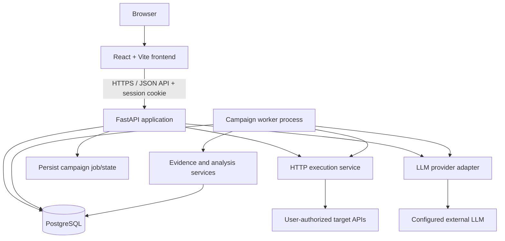

# TECHNICAL_DESIGN.md

**Project:** API Intelligence Platform  
**Status:** Proposed implementation design; subordinate to `SOURCE_OF_TRUTH.md`  
**Version:** 1.0  
**Last updated:** 2026-10-16  
**Purpose:** Define the system architecture, module responsibilities, data flows, security boundaries, interfaces, and implementation rules needed to build the approved MVP.

> This document turns the approved product baseline into an implementable design. Where the source of truth leaves a detail open, this document proposes a default. A proposed default becomes binding once accepted and should be changed through a documented decision rather than silently diverging in code.

## 1. Design Goals and Non-Goals

### 1.1 Goals

- Deliver a working API-client workflow without an LLM provider.
- Keep deterministic execution and validation separate from AI-assisted reasoning.
- Support repeatable test campaigns whose state and evidence survive application restarts.
- Preserve provenance for API facts, hypotheses, executions, and findings.
- Make backend modules independently testable and implementable against stable contracts.
- Run locally through Docker Compose and support a later deployment without application-level host assumptions.
- Keep the architecture small enough for a student team and a time-constrained MVP.

### 1.2 Non-goals for the MVP

- Reimplementing every Postman feature or its scripting runtime.
- Microservices, Kubernetes, Redis/Celery as mandatory infrastructure, or a separate vector/graph database.
- Training a custom machine-learning model.
- Guaranteeing exhaustive discovery of undocumented APIs.
- Running arbitrary user-supplied code against the backend.
- Claiming continuous monitoring unless a reliable scheduler and operational monitoring are implemented.

## 2. High-Level Architecture

The application is a modular monolith with distinct frontend, API, worker, and database runtime processes. The API and worker share the same backend package and domain services; they are separate processes so long-running campaigns do not occupy request-handling workers.



### 2.1 Runtime responsibilities

- **Frontend:** navigation, forms, request configuration, response inspection, campaign controls, and evidence presentation. It does not hold provider secrets or make privileged target-execution decisions.
- **API service:** authentication, authorization, input validation, CRUD operations, request orchestration, campaign submission/status, and report retrieval.
- **Campaign worker:** claims persisted campaign work, executes bounded iterations, records evidence, and transitions campaign state. It must recover or mark interrupted work after a restart.
- **PostgreSQL:** authoritative store for users, projects, saved API assets, campaigns, executions, evidence, and job state.
- **Execution service:** the only module permitted to issue outbound requests to target APIs. It enforces URL validation, redirect policy, timeouts, response limits, and request budgets.
- **LLM adapter:** optional external reasoning and test-candidate generation. It is never responsible for directly sending target requests or bypassing validation.

### 2.2 Architectural constraints

1. The backend is one Python package with explicit modules, not a collection of networked microservices.
2. Route handlers call application services; they must not contain domain workflows or direct HTTPX calls to target APIs.
3. ORM models are persistence mappings, not the place for cross-module business workflows.
4. Pydantic models define API and internal boundary payloads. SQLAlchemy models define persisted records.
5. Cross-module calls should use public service functions or schemas, not private implementation details.
6. Avoid circular imports. Shared primitives belong in a small `common` or `core` package only when genuinely shared.
7. All side effects (database access, target HTTP calls, LLM calls, file/URL imports) must be explicit and testable.

## 3. Proposed Repository Layout

Names may be adapted to the existing repository, but preserve the boundaries and ownership below.

```text
.
├── apps/
│   ├── web/
│   │   ├── src/
│   │   │   ├── app/                 # router, providers, application shell
│   │   │   ├── components/          # shared visual primitives
│   │   │   ├── features/
│   │   │   │   ├── overview/
│   │   │   │   ├── api-workspace/
│   │   │   │   ├── health-checks/
│   │   │   │   ├── api-explorer/
│   │   │   │   ├── campaigns/
│   │   │   │   ├── findings/
│   │   │   │   ├── collections/
│   │   │   │   ├── environments/
│   │   │   │   └── history/
│   │   │   ├── lib/                 # query client, utilities
│   │   │   ├── services/            # typed API client modules
│   │   │   ├── mocks/               # explicit demo fixtures/services
│   │   │   └── styles/              # tokens and global styles
│   │   └── ...
│   └── api/
│       ├── app/
│       │   ├── main.py
│       │   ├── core/                # settings, errors, logging, security primitives
│       │   ├── db/                  # engine, session, base, migrations integration
│       │   ├── auth/
│       │   ├── projects/
│       │   ├── api_understanding/
│       │   ├── knowledge/
│       │   ├── execution/
│       │   ├── test_generation/
│       │   ├── analysis/
│       │   ├── adaptive/
│       │   ├── campaigns/
│       │   ├── evidence/
│       │   ├── reports/
│       │   └── integrations/
│       │       └── llm/
│       ├── alembic/
│       ├── tests/
│       └── pyproject.toml
├── docs/
│   ├── SOURCE_OF_TRUTH.md
│   ├── TECHNICAL_DESIGN.md
│   ├── API_CONTRACT.md
│   ├── DATABASE_DESIGN.md
│   ├── DEVELOPMENT_WORKFLOW.md
│   └── decisions/
├── docker-compose.yml
├── .env.example
└── .github/workflows/ci.yml
```

If the current repository uses a different workspace layout, adapt paths without changing module ownership or responsibilities. Keep one authoritative copy of each design document; do not duplicate documents in multiple directories.

## 4. Backend Module Responsibilities and Dependencies

### 4.1 Module map

| Module | Owns | Must not own |
|---|---|---|
| `auth` | Google identity verification, app session, current-user resolution, auth routes | Project-specific business logic |
| `projects` | Projects, project membership/ownership checks, saved requests, collections, environments, history metadata | Outbound HTTP execution internals |
| `api_understanding` | OpenAPI parsing, operation/parameter/schema extraction, contract representation, cURL parsing if included | Campaign lifecycle or LLM provider details |
| `knowledge` | Versioned API facts, provenance, observed schema summaries, inferred hypotheses | Raw unrestricted prompt construction across the app |
| `execution` | Target URL validation, HTTP request construction, transport, response capture, budgets/timeouts | AI reasoning or finding classification |
| `test_generation` | Test candidate definitions, deterministic templates, optional LLM-assisted candidate generation, candidate validation | Executing target requests directly |
| `analysis` | Assertions, schema comparison, observation normalization, finding candidates | Changing raw execution evidence |
| `adaptive` | Interestingness score, candidate ranking, next-test selection and rationale | Owning campaign persistence or sending requests |
| `campaigns` | Campaign configuration/state transitions, iteration budget, worker coordination and recovery | Implementing provider-specific LLM calls |
| `evidence` | Persisted execution evidence, links between tests/responses/assertions/findings, provenance | Rewriting evidence after the fact |
| `reports` | Aggregated campaign summaries and coverage calculations | Running target requests or changing campaign state |
| `integrations/llm` | Provider interface, provider implementations, timeout/retry policy, structured-output parsing | Application authorization or target execution |
| `core` / `db` | Settings, logging, error types, database session and shared technical primitives | General-purpose dumping ground for domain logic |

### 4.2 Allowed dependency direction

Use this direction as the default. Dependencies may point downward, not back upward.

```text
HTTP routes
    ↓
Application services / use cases
    ↓
Domain modules and interfaces
    ↓
Infrastructure adapters (database, HTTP transport, LLM provider)
```

Recommended workflow dependencies:

- `campaigns` orchestrates `test_generation`, `execution`, `analysis`, `adaptive`, and `evidence` through public interfaces.
- `test_generation` may use `api_understanding`, `knowledge`, and the LLM adapter.
- `analysis` consumes execution results and API contract representations; it emits structured observations and candidate findings.
- `adaptive` consumes validated candidates and persisted/normalized evidence; it returns ranked next actions with reasons.
- `reports` reads campaign/evidence services and computes explicitly defined metrics.
- `execution` does not import `campaigns`, `adaptive`, or `integrations/llm`.

If a dependency cycle appears, extract a small shared schema/interface or move orchestration into an application service. Do not solve cycles by importing private functions across modules.

## 5. Frontend Design

### 5.1 Route structure

Use a centralized React Router configuration and a shared authenticated application layout. Route names should be stable and correspond to the six primary destinations:

- `/overview`
- `/workspace`
- `/health-checks`
- `/explorer`
- `/campaigns`
- `/findings`

Supporting routes may include `/collections`, `/environments`, `/history`, and `/login`. Use route parameters for selected resources, for example `/campaigns/:campaignId` and `/findings/:findingId`, after the API contract is defined. Include loading, error, empty, and not-found states.

### 5.2 Feature organization

Each feature owns its page-level components, feature-specific hooks, schemas, and local view types. Shared UI primitives, navigation, design tokens, and API transport must not be duplicated inside features.

- `services/` contains typed HTTP calls to the backend.
- TanStack Query owns server-state caching, loading, invalidation, and refetching.
- React Hook Form + Zod are used for complex forms where they materially help.
- Component-local state is appropriate for transient UI state such as selected tabs or unsaved request editor input.
- Do not store session credentials in `localStorage`.
- Demo data must be injected through an explicit mock service or fixture layer, never silently substituted after a real API failure.

### 5.3 API client behavior

Create a single configured frontend API client. It should:

- Use a configurable API base URL.
- Send credentials/cookies when required by the selected same-origin or development topology.
- Normalize the backend error envelope.
- Avoid logging secrets or full sensitive request bodies.
- Provide typed feature service modules rather than raw `fetch` calls scattered across pages.

Generate frontend types from the FastAPI OpenAPI document when practical. Until generation is automated, keep types aligned with `API_CONTRACT.md` and add contract validation to CI.

## 6. Authentication and Session Design

### 6.1 Proposed flow

Use Google sign-in in the browser, then verify the Google ID token on the FastAPI backend. After verification, the backend creates or resolves the application user and issues an application session. Google tokens are identity proof, not the application's long-lived session credential.

1. Browser initiates Google sign-in using the approved Google client configuration.
2. Browser sends the returned ID token to a dedicated backend sign-in endpoint over HTTPS.
3. Backend validates signature, issuer, audience, expiration, and required claims using a supported Google verification library.
4. Backend resolves the user by stable Google subject identifier; email alone is not the stable primary identity.
5. Backend creates or reuses an application session and returns a secure session cookie.
6. Subsequent requests authenticate through that cookie; the backend resolves the user and checks resource ownership.
7. Logout invalidates the server-side session and clears the cookie.

### 6.2 Session default

**Recommended default:** opaque, random session identifier in an `HttpOnly` cookie, with session state stored in PostgreSQL. This provides server-side revocation and avoids placing a long-lived bearer token in browser storage.

- Cookie flags: `HttpOnly`; `Secure` in HTTPS environments; an appropriate `SameSite` setting; narrow path/domain scope.
- Prefer serving the frontend and API under the same origin in production, using a reverse proxy if needed.
- In local development, configure explicit allowed origins and credentialed CORS; never use wildcard origins with credentials.
- If cross-site cookies are required, document the topology and use the corresponding `SameSite=None; Secure` and CSRF protections.
- Use a CSRF token or another documented CSRF defense for state-changing cookie-authenticated requests.
- Session lifetime, idle expiry, rotation, and cleanup must be defined in configuration and tested.
- Never accept a client-supplied user ID as authorization. Derive the current user from the verified session.

### 6.3 Authorization

Every resource query or mutation must be scoped to the authenticated user's ownership or explicit membership. Authorization belongs in reusable service/dependency functions and must be checked server-side on every request. Return a consistent not-found or forbidden response without leaking other users' resource metadata.

## 7. Data and Persistence Design Principles

The exact schema belongs in `DATABASE_DESIGN.md`; this section defines the conceptual model and constraints.

### 7.1 Conceptual entities

- **User:** application identity linked to a stable Google subject.
- **Session:** revocable authenticated browser session.
- **Project:** user-owned grouping boundary for API assets and testing activity.
- **Collection:** named grouping of saved requests.
- **SavedRequest:** method, URL template, parameter/header/body configuration, auth reference, and collection/project association.
- **Environment:** named variable set scoped to a project; secret values require protected handling and redaction.
- **ApiSpecification:** imported OpenAPI document/version and parse status.
- **ApiOperation:** normalized operation extracted from a specification, with provenance back to the source.
- **KnowledgeFact / Hypothesis:** normalized fact or inference with provenance, confidence/strength where appropriate, and source references.
- **Campaign:** test plan, budgets, state, progress, configuration, and lifecycle timestamps.
- **TestCase:** validated candidate test definition, generation source, target operation, and rationale.
- **Execution:** one attempted target request, with timing, transport outcome, response metadata, and safe body capture.
- **AssertionResult:** deterministic assertion/schema check and outcome.
- **Finding:** candidate or confirmed issue classification, severity/priority, status, and linked evidence.
- **EvidenceReference:** links findings and adaptive decisions to execution IDs, response excerpts, contract locations, and assertion results.
- **CampaignJob / lease metadata:** durable worker claim and recovery state if required by the chosen worker implementation.

Do not force every conceptual entity into a separate table without evaluating MVP needs. `DATABASE_DESIGN.md` must specify exact tables, keys, foreign keys, indexes, uniqueness constraints, deletion policy, and retention.

### 7.2 Persistence rules

- Use UUIDs or another consistently chosen opaque identifier strategy for externally visible resources.
- Include `created_at` and `updated_at` where they are meaningful; store timestamps in UTC.
- Enforce ownership relationships and uniqueness in the database as well as in application logic where possible.
- Use transactions for state transitions that must be atomic, such as claiming a job or saving an execution and its primary evidence records.
- Do not store environment secrets or authorization values as plaintext without a deliberate security decision. If encryption at rest at the application layer is implemented, the encryption key must be external to the database and configured securely.
- Redact credentials, cookies, authorization headers, and configured secret variables from logs, findings, and report output.
- Evidence retention must be bounded by configurable policies; avoid unlimited storage of large response bodies.
- Preserve raw execution outcome separately from later analysis so findings can be recomputed without falsifying the original observation.

## 8. HTTP API Design Rules

The complete endpoint list and payload schemas belong in `API_CONTRACT.md`. Use these rules when creating that contract.

- Prefix application routes with `/api/v1`.
- Use resource-oriented nouns and standard HTTP semantics.
- Use Pydantic request/response models; do not expose SQLAlchemy models directly.
- Return a consistent error envelope containing a stable machine-readable code, a human-readable message, and optional structured details/request ID. Do not include stack traces or secrets in client errors.
- Use explicit pagination for potentially large collections. Choose one pagination scheme and apply it consistently; cursor pagination is preferable for large execution/evidence histories, while page/limit may be adequate for small project resources.
- Validate all IDs, filters, sort keys, body sizes, and state transitions.
- Apply authorization to every resource route, including nested resources and download/export operations.
- Document expected status codes and idempotency behavior.
- Campaign creation should return a persisted campaign identifier and initial state; campaign status is fetched separately. Do not keep an HTTP request open for the full campaign.
- Long-running actions should expose state/progress and an explicit cancellation endpoint only if cancellation semantics are implemented.
- Never expose provider credentials, raw session identifiers, or internal exception details.

## 9. Core Execution Engine

The execution engine is a security-critical shared service. Manual requests, health checks, and campaign tests must use the same transport and safety policy rather than implementing independent HTTP clients.

### 9.1 Input pipeline

1. Accept a typed request definition from the authorized caller.
2. Resolve environment variables using a defined interpolation policy.
3. Validate the method, URL scheme, host, path, query, headers, and body limits.
4. Resolve and validate destination addresses before connection; reject disallowed IP ranges by default.
5. Apply the redirect policy, revalidating every redirect target before following it. The safest MVP default is to disable automatic redirects or handle redirects manually with a small limit and revalidation at every hop.
6. Apply connection/read/total timeouts, response byte limits, and concurrency/request-budget limits.
7. Execute through the configured HTTP client with TLS verification enabled by default.
8. Capture status, timing, safe response headers, content type, bounded response body, and transport errors.
9. Redact secrets and persist the execution result/evidence.

### 9.2 SSRF and outbound request policy

Recommended MVP defaults:

- Permit only `http` and `https` schemes.
- Reject URL credentials (`user:password@host`) and malformed or ambiguous host forms.
- Reject loopback, private, link-local, multicast, unspecified, reserved, and cloud metadata destinations by default for both IPv4 and IPv6.
- Resolve hostnames and validate all resolved addresses. Avoid a validation-then-connect gap where feasible; use a transport/connector strategy that pins or verifies the resolved destination. Revalidate after DNS changes and on every redirect.
- Do not allow a redirect to bypass host/IP checks. Limit redirect count and reject redirects to prohibited addresses.
- Do not fetch arbitrary remote `$ref` documents from imported OpenAPI files by default. Resolve local references in the imported document; external references require a separately constrained fetch path.
- Cap request and response sizes, total execution duration, concurrent executions, and campaign-wide requests.
- Make target allowlisting configurable. For local development, explicit opt-in access to loopback targets may be useful, but it must be disabled by default in shared/production deployments and must not weaken checks globally.
- Provide an explicit error result for blocked targets; do not silently rewrite URLs.
- Keep TLS certificate verification enabled by default. Any unsafe override must be an explicit development-only setting and must not be enabled in production.

A simple string check is not sufficient SSRF protection. The implementation and tests must address IP literal normalization, IPv6, DNS resolution, redirects, and DNS rebinding.

### 9.3 Response capture and redaction

- Enforce a configurable maximum response-body size; preserve truncation metadata.
- Capture only relevant response headers and redact sensitive headers such as `Set-Cookie` and authentication-related values.
- Parse JSON only when the response content type/body supports it; preserve a raw bounded representation as appropriate.
- Treat response content as untrusted; do not render HTML as trusted markup in the frontend.
- Store response bodies only as long as needed for debugging and evidence, subject to retention policy and project authorization.

## 10. API Understanding and Provenance

The API understanding subsystem must preserve the difference between what the specification says, what deterministic parsing extracts, what the system infers, and what executions demonstrate.

### 10.1 Provenance categories

Use a stable enum or equivalent:

- `DECLARED`: directly stated in an imported OpenAPI document or user-supplied contract.
- `EXTRACTED`: deterministically parsed from a document, URL template, schema, or response.
- `OBSERVED`: directly captured from an actual execution.
- `INFERRED`: a hypothesis produced by rules or an LLM from available evidence.

Store a source reference for each fact when possible: specification/version and JSON Pointer, execution ID and JSON path, or inference run and input evidence IDs. Inferred facts should include confidence/strength and a short rationale when available. Confidence is not proof.

### 10.2 OpenAPI import

- Accept an uploaded file and, if enabled, a URL.
- Enforce file/body size limits, content-type and parse-time limits.
- Parse supported OpenAPI versions with a maintained parser or validated library.
- Report unsupported constructs and partial-import warnings rather than pretending the import was complete.
- Do not execute API operations during import.
- Do not automatically dereference external URLs. Imported specification text is untrusted input.
- Store a version/hash and parse result so later analysis can identify which contract version was used.

### 10.3 Observed schema analysis

Observed response shapes may be compared to declared response schemas. A mismatch is a **contract discrepancy** or **candidate finding**, not automatically a confirmed bug. Account for documented status codes, content types, optional fields, and schema dialect/validator limitations.

## 11. Test Generation and Candidate Validation

### 11.1 Candidate categories

The MVP should support a practical subset of:

- Positive tests based on required fields and documented examples.
- Negative tests for missing, malformed, or invalid values.
- Boundary tests for numeric/string/array limits and optional/required fields.
- Response schema and documented-status validation.
- Workflow tests only where a safe, understandable resource sequence can be derived.

Each candidate should contain a stable ID, target operation or request template, category, rationale, input mutations, expected checks, source provenance, and any required prerequisites. Keep candidate definitions declarative; do not run arbitrary generated code.

### 11.2 Generation pipeline

1. Build context from the selected API operation, applicable specification, relevant knowledge facts, environment configuration, and prior evidence.
2. Produce candidates using deterministic templates and optionally the LLM adapter.
3. Parse model output into a strict Pydantic schema.
4. Reject candidates with unsupported methods, invalid parameter locations, unresolved variables, unsafe URLs, oversized payloads, or unbounded loops/sequences.
5. Apply authorization and execution-policy checks immediately before execution as well; validation at generation time is not sufficient.
6. Deduplicate candidates and rank them before consuming the campaign budget.
7. Persist accepted/rejected candidates and a reason code for rejection where useful.

If the LLM is unavailable, deterministic candidate templates remain usable. The UI must distinguish deterministic and AI-assisted generation.

## 12. Deterministic Analysis and Findings

Analysis consumes an immutable execution record plus contract and test expectations, then produces normalized observations.

Examples of observations:

- Transport timeout or connection failure.
- HTTP status outside the test's expected status set.
- Response schema mismatch.
- Missing required field or unexpected type.
- Documented contract discrepancy.
- Inconsistent response behavior across comparable executions.
- Potentially interesting boundary behavior.

### 12.1 Finding lifecycle

Use distinct concepts for:

- **Observation:** a recorded fact about an execution.
- **Candidate finding:** a pattern worth review, with supporting evidence and confidence where applicable.
- **Confirmed finding:** a user-reviewed or rule-confirmed issue under an explicitly documented rule.

Do not automatically mark every unexpected response as a confirmed vulnerability or defect. A finding should link to the evidence and checks that support it, include a reproducible request where safe, and explain why it was raised.

### 12.2 Determinism

Core assertions, status checks, schema validation, redaction, budget enforcement, and state transitions must be deterministic and unit-testable. LLM output can help interpret or propose tests but cannot replace these checks.

## 13. Adaptive Test Selection

The adaptive module ranks eligible next tests based on observed evidence. Start with a weighted, explainable heuristic; do not train a model for the MVP.

Potential score components:

- **Unexpectedness:** how far the observed result differs from the expected result or declared contract.
- **Novelty:** whether the response shape, status, error class, or behavior is new relative to the campaign evidence.
- **Boundary relevance:** whether the result suggests an untested schema boundary or input partition.
- **Inconsistency:** whether comparable requests produce materially different results.
- **Exploration value:** whether a follow-up could distinguish competing hypotheses or cover an unexplored documented branch.
- **Cost/risk penalty:** expected request cost, destructive potential, rate-limit risk, and uncertainty about side effects.

The precise weights and normalization belong in a small, versioned configuration and must be tested. Never let a high interestingness score override safety policy, authorization, or the remaining request budget.

Each adaptive decision must persist:

- Candidate IDs considered (or a bounded summary if the list is large).
- Selected candidate and rank/score components.
- Evidence IDs used.
- Selection rationale.
- Scoring-policy version.
- Whether selection was deterministic or AI-assisted.

## 14. Campaign Lifecycle and Worker Recovery

### 14.1 Proposed campaign states

Use a documented state machine. Initial proposal:

`DRAFT → QUEUED → RUNNING → COMPLETED`

Terminal/exceptional states: `FAILED`, `CANCELLED`, and `PAUSED` only if pause/resume is fully implemented. A queued/running campaign interrupted by process failure must be recoverable or transitioned to a clearly reported failure state. Exact transition guards belong in `API_CONTRACT.md` and `DATABASE_DESIGN.md`.

### 14.2 Worker strategy

**Recommended MVP default:** a dedicated worker process that polls PostgreSQL for queued campaigns/jobs and claims work using a transaction-safe claim/lease mechanism. This avoids adding Redis/Celery while making execution state durable.

- API request creates and commits a campaign/job record, then returns promptly.
- Worker claims one unit of work with a lease/heartbeat and records progress.
- Worker executes a bounded step, stores the execution and evidence, updates campaign progress, and then selects the next step.
- On startup, worker scans expired leases and reconciles interrupted jobs.
- A job claim must be safe against two workers claiming the same work concurrently.
- Each iteration has explicit limits and idempotency/recovery rules. Do not assume a target request can always be safely repeated after a crash.
- Persist the fact that an attempt may have been in-flight at crash time; do not silently report it as never executed.
- The MVP may use one worker replica. Database locking and state transitions should still be correct if another worker is later added.
- Graceful shutdown should stop claiming new work and persist a resumable/interrupted state for active work where possible.

If this implementation is too large for the available time, ship campaigns as a clearly bounded synchronous/manual sequence first, but do not label in-process `BackgroundTasks` as durable. Any reduction must be recorded as a scope decision and reflected in the UI and docs.

### 14.3 Budgets and stop conditions

A campaign must have configurable maximum requests/iterations, per-request timeout, total deadline, and response-size limits. Stop when a budget is exhausted, no valid candidates remain, cancellation is requested, a fatal configuration error occurs, or the campaign deadline is reached. Persist a machine-readable stop reason and expose it in the UI.

## 15. LLM Provider Adapter

### 15.1 Interface

The application should depend on a provider-neutral interface, not a specific vendor SDK throughout the codebase. Conceptual operations may include:

- `generate_test_candidates(context, constraints) -> CandidateBatch`
- `analyze_evidence(context, constraints) -> AnalysisSuggestion` only if the MVP needs this feature

Use strict Pydantic schemas for outputs. Validate shape, allowed enum values, lengths, references, and resource bounds before using any output.

### 15.2 Adapter responsibilities

- Load credentials only from backend environment/secrets configuration.
- Apply connect/read/total timeouts and bounded retries for retryable errors.
- Classify quota, authentication, network, timeout, and invalid-output errors.
- Log provider/model metadata and timing without logging credentials or sensitive prompt contents.
- Enforce configured per-campaign and global usage limits where possible.
- Support a fake deterministic provider for tests.
- Fail clearly when unconfigured; do not silently invent an AI result.

### 15.3 Data minimization

Send only the context needed for the task. Redact secrets and avoid including real credential values, cookies, authorization headers, or unnecessary personal data. API schemas and responses may contain confidential information; LLM use should be configurable and clearly disclosed to the user. Do not send target request secrets to the provider.

### 15.4 Provider choice

Keep the provider implementation configurable. Before production use, select a provider/model and define request/token/cost limits, retention/data-use requirements, and structured-output support. Ordinary API workspace and deterministic tests must continue to work if no provider is configured.

## 16. Health Checks, History, and Reports

- A manual health check is an execution plus explicitly configured checks, not a separate HTTP transport implementation.
- Health check results must distinguish connection failure, timeout, HTTP response status, and assertion result.
- Request history is derived from persisted executions and must redact secrets.
- Reports aggregate persisted test, assertion, finding, and campaign data. Report metrics must define their denominator and inclusion rules.
- Coverage metrics should initially be conservative: for example, documented operations attempted / documented operations in scope, or assertions passed / assertions executed. Do not use vague “AI coverage” claims without a measurable definition.
- Any export feature must apply the same authorization and redaction policy as the UI.

## 17. Error Handling, Observability, and Configuration

### 17.1 Error handling

Use stable internal error categories and map them to a consistent HTTP API envelope. Distinguish validation errors, authentication/authorization errors, resource-not-found errors, target transport errors, target HTTP responses, provider errors, and internal failures. A target API returning HTTP 500 is an execution result; it is not automatically an internal failure of this platform.

### 17.2 Logging

Use structured logs with request/correlation IDs. Log operation names, resource IDs, durations, outcome categories, and worker state changes. Never log passwords, session IDs, provider API keys, authorization headers, cookies, or unredacted sensitive bodies. Keep user-visible error messages useful without exposing stack traces.

### 17.3 Configuration

Centralize backend configuration in a validated settings object. `.env.example` documents required and optional variables without real credentials. At minimum, configuration will cover:

- Database connection and pool settings.
- Google OAuth/client audience and session settings.
- Allowed frontend origins and deployment/public base URL as needed.
- Session cookie/CSRF settings.
- Target request connect/read/total timeouts, size limits, redirect policy, concurrency, and target allowlist options.
- Campaign budgets, worker poll/lease settings, and retention limits.
- LLM provider/model, credentials, timeout, retry, and quota settings.
- Logging level and environment mode.

Fail fast on invalid required configuration, but do not make LLM credentials mandatory for application startup.

## 18. Docker and Deployment Topology

### 18.1 Local development

Docker Compose should provide:

- `web`: Vite development server for local development; production build served separately for release validation.
- `api`: FastAPI application.
- `worker`: campaign worker using the same backend image/package and configuration.
- `db`: PostgreSQL with a named volume and health check.

Use service DNS names in container-to-container URLs; do not use `localhost` to refer to another container. Keep secrets in environment configuration, not the image. Use health checks and documented startup/migration commands. Do not automatically run concurrent schema migrations from every API/worker replica.

### 18.2 Production readiness

- Build production frontend assets and serve them through a web server/reverse proxy or an approved deployment service.
- Put frontend and API behind a compatible HTTPS origin where practical to simplify secure cookies and CSRF configuration.
- Run migrations as a controlled release step.
- Use non-root containers where practical, pinned dependencies, minimal images, and explicit health/readiness checks.
- Configure database backups, retention, secrets management, and operational limits before handling important data.
- No specific public hosting provider is required by this design.

## 19. Testing Strategy

### 19.1 Backend

- Unit tests for URL policy, redaction, request construction, schema validation, assertions, interestingness scoring, candidate validation, and campaign transitions.
- Service tests for authorization, persistence, and transaction boundaries.
- Integration tests against PostgreSQL for migrations, constraints, job claiming, evidence persistence, and recovery.
- HTTP execution tests against local mock servers with controlled responses, redirects, slow endpoints, oversized bodies, and malformed payloads.
- Authentication tests for invalid/expired/wrong-audience Google tokens, session expiry/revocation, CSRF behavior, and cross-user access.
- LLM tests use a deterministic fake provider by default; real provider tests are opt-in.
- Security tests must include private/loopback/link-local addresses, IPv4/IPv6 variations, redirects, DNS edge cases where testable, oversized input, and secret redaction.

### 19.2 Frontend

- Unit/component tests for request editor state, response rendering, error states, campaign progress, findings/evidence, and form validation.
- Service tests for API error normalization and authentication behavior.
- End-to-end tests for sign-in/session handling (using a controlled test setup), create/send request, import a specification, create/run campaign, and inspect evidence.
- Mock data must be explicit and deterministic.

### 19.3 CI

GitHub Actions should run frontend lint/typecheck/tests/build, backend lint/typecheck/tests, contract checks, and Docker builds. Add database integration and migration checks as the database layer is introduced. CI must not require real Google credentials or a live LLM provider; use test doubles and controlled configuration.

## 20. Implementation Sequence and Ownership

### Stage 0 — Design and contract freeze

**Integration lead owns:** `SOURCE_OF_TRUTH.md`, this document, API contract, database design, ADRs, repository boundaries, and initial CI requirements.

Deliverables:
- `TECHNICAL_DESIGN.md` accepted.
- `API_CONTRACT.md` drafted for the first vertical slice.
- `DATABASE_DESIGN.md` drafted for auth, project/request storage, campaigns, executions, and evidence.
- Explicit module ownership and branch/PR workflow.

### Stage 1 — Frontend first

**User owns:** route shell, design tokens, reusable components, six primary destinations, supporting routes, and typed mock services.

Acceptance:
- Direct route navigation and refresh work.
- Shared navigation/layout and design tokens are centralized.
- Mock behavior is visibly separated from real API behavior.
- Pages cover loading, empty, error, and success states where relevant.
- Frontend lint, typecheck, tests, and production build pass.

### Stage 2 — Backend scaffold and integration foundation

**Integration lead owns:** FastAPI application skeleton, configuration, database session/migrations, common error format, auth/session foundation, contract validation, Docker Compose, and CI.

Acceptance:
- API and worker start without LLM configuration.
- PostgreSQL migration can run from a clean database.
- Health/readiness endpoint works.
- Authenticated requests resolve a current user; ownership checks are tested.
- A deterministic integration test can create and read a user-owned resource.

### Stage 3 — Core API utility vertical slice

**Integration lead owns execution foundation**, including safe outbound request policy and saved request flow. Deliver a vertical slice before broadening feature count:

`Create/configure request → execute safely → inspect response → persist history/evidence`.

Then add OpenAPI import, health checks, assertions, environments, and collections incrementally.

### Stage 4 — Intelligence modules

**Second developer owns bounded modules:** test candidate generation, deterministic analysis/assertions, interestingness scoring, and adaptive selection, against approved Pydantic contracts. Exact allocation should be recorded in the task board/PRs.

**Integration lead owns:** campaign orchestration, persistence, worker recovery, integration, and final end-to-end acceptance unless ownership is explicitly revised.

### Stage 5 — Integration and release readiness

- Run end-to-end workflows using controlled target APIs.
- Verify budgets, recovery, ownership, redaction, SSRF protections, and provider-unavailable behavior.
- Verify Docker Compose from a clean checkout.
- Confirm documented limitations and no UI claims exceed implemented behavior.

## 21. Definition of Done for Modules

Each module must include:

1. A clear public interface and responsibility statement.
2. Pydantic schemas or domain types for its boundary inputs/outputs.
3. Unit tests for success, invalid input, boundary, and failure paths.
4. Persistence/transaction tests where relevant.
5. Structured errors and safe logging.
6. No unauthorized cross-module imports or duplicated transport logic.
7. Updated documentation and a runnable example or test.
8. Passing CI and a reviewed integration path.

## 22. Decisions to Finalize in Companion Documents

The architecture can proceed with the defaults proposed here, but these details must be made explicit before the relevant feature is implemented:

1. **API contract:** exact routes, payloads, error envelope, pagination, campaign states, cancellation behavior, and generated OpenAPI/type workflow.
2. **Database design:** exact tables/relationships/indexes, ownership constraints, session storage, job lease/claim strategy, cascade/delete rules, and evidence retention.
3. **Google configuration:** authorized origins, client ID/audience, session lifetime, cookie flags, and CSRF implementation for local and production topology.
4. **Worker scope:** durable DB-backed worker versus a deliberately reduced synchronous campaign MVP. Do not misrepresent a non-durable background task as reliable.
5. **LLM provider:** provider/model, structured output support, budget/quota, data retention terms, and which features invoke it. Keep adapter and deterministic fallback either way.
6. **SSRF implementation:** exact allowed target policy, local-target opt-in behavior, DNS pinning/validation approach, redirect policy, limits, and tests.
7. **Optional API-client features:** cURL import/export, OAuth variants, and scripts. Treat these as scope-controlled; do not let them delay the core vertical slice.

## 23. Implementation Rules for Coding Agents

Before editing:

- Read `SOURCE_OF_TRUTH.md`, this document, and the relevant contract/design document.
- Inspect the current repository and existing conventions; do not assume the tree is empty.
- Identify the exact files to change and the public interface being implemented.
- Do not invent routes, database fields, enum values, or shared types when the contract is missing. Propose the smallest contract update and wait for integration-lead review where needed.

While editing:

- Keep changes scoped to the assigned module and file ownership.
- Do not change shared config, migrations, common schemas, or module boundaries without review.
- Add tests with implementation; do not leave tests as a later task.
- Do not add dependencies or infrastructure without a concrete need and documented justification.
- Never weaken target-execution safety to make a test pass.
- Keep secrets and real credentials out of source control, fixtures, logs, screenshots, and prompts.

Before handing off:

- Run the relevant formatter, linter, type checker, tests, and build checks.
- Report changed files, design decisions, test commands/results, limitations, and any contract gap.
- Do not claim checks passed unless they were actually run.
- Do not commit or push unless explicitly requested by the repository workflow.

---

**Authority note:** If this document conflicts with `SOURCE_OF_TRUTH.md`, the source of truth wins. If implementation reveals a necessary architectural change, document the proposed change and rationale before silently changing the design.
